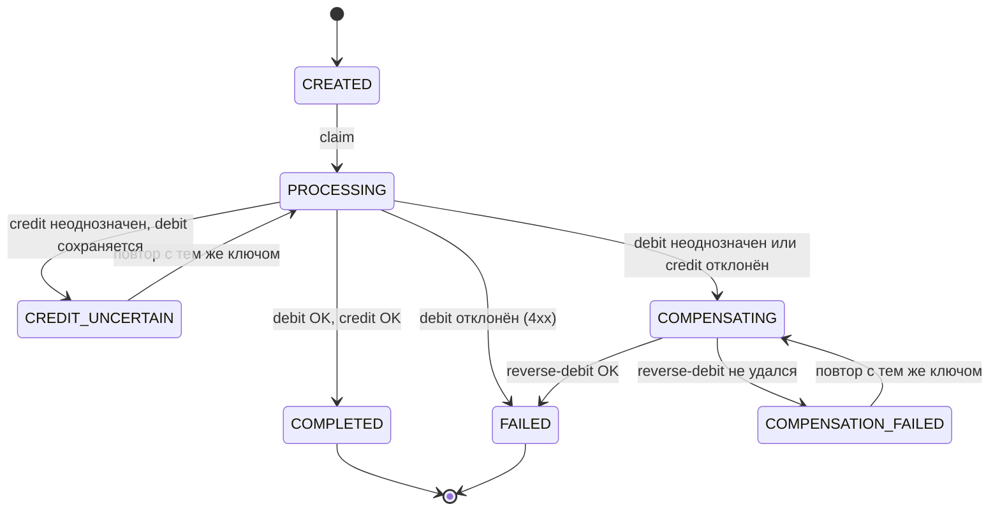
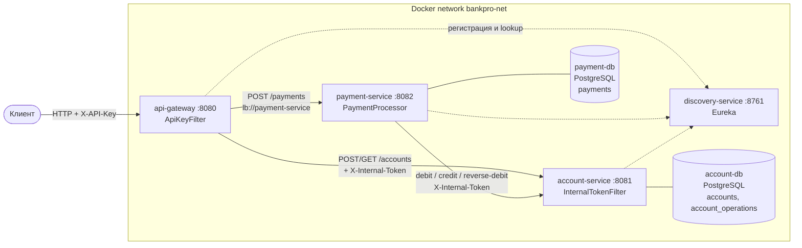
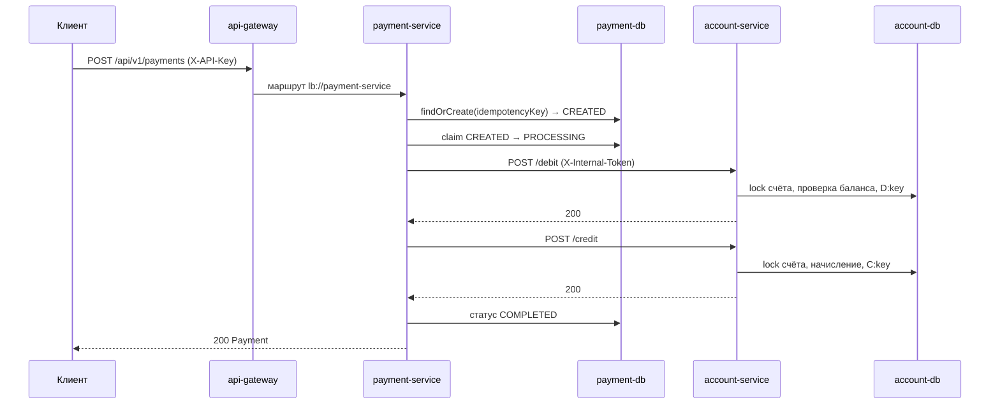
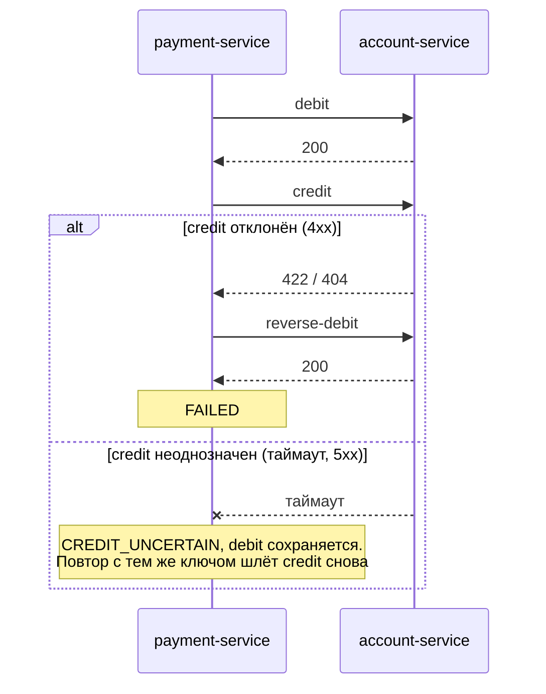
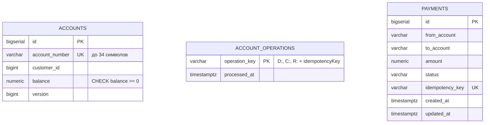

# BankPro — анализ функционала, план и системный дизайн

Документ описывает состояние проекта на ветке `develop` (коммит `f1a8d43`). Диаграммы написаны на Mermaid и отображаются в GitHub и IntelliJ IDEA (встроенный Markdown-просмотр).

## 1. Обзор

BankPro — учебное микросервисное банковское приложение. Сейчас оно умеет:
- открывать счета и показывать счёт по номеру;
- переводить деньги между двумя счетами с гарантиями идемпотентности и компенсацией при сбоях.

**Стек:** Java 24, Spring Boot 3.5.5, Spring Cloud 2025.0.0 (Gateway WebFlux, Eureka), PostgreSQL 15, Flyway, Maven (multi-module), Docker Compose, JUnit 5 + Mockito.

## 2. Модули

| Модуль | Порт | Роль |
|---|---|---|
| `common-dto` | — | Общая библиотека: `TransferRequest` (fromAccount, toAccount, amount ≥ 0.01, idempotencyKey ≤ 64) |
| `discovery-service` | 8761 | Eureka-реестр сервисов |
| `api-gateway` | 8080 | Единственная публичная точка входа, проверка `X-API-Key`, маршрутизация через `lb://` |
| `account-service` | 8081 | Счета и операции по балансу (debit / credit / reverse-debit). БД `accountdb` |
| `payment-service` | 8082 | Оркестрация перевода (debit → credit) с ретраями и компенсацией. БД `paymentdb` |

## 3. Текущий функционал

### 3.1 Публичный API (через gateway, заголовок `X-API-Key`)

| Метод и путь | Сервис | Назначение |
|---|---|---|
| `POST /api/v1/accounts` | account | Создать счёт (`accountNumber`, `customerId`, `initialBalance`) → 201, 409 если номер занят |
| `GET /api/v1/accounts/{accountNumber}` | account | Получить счёт → 200 / 404 |
| `POST /api/v1/payments` | payment | Создать и провести перевод по `TransferRequest` |

### 3.2 Внутренний API (только payment-service → account-service, заголовок `X-Internal-Token`)

| Метод и путь | Назначение |
|---|---|
| `POST /api/v1/accounts/debit` | Списать сумму с `fromAccount` |
| `POST /api/v1/accounts/credit` | Зачислить сумму на `toAccount` |
| `POST /api/v1/accounts/reverse-debit` | Откатить списание (компенсация) |

Эти три маршрута в gateway не опубликованы, а `account-service` не имеет внешних портов в Docker Compose.

### 3.3 Ключевые механизмы

**Идемпотентность и конкурентность в account-service**
- Каждая операция сначала берёт пессимистичную блокировку строки счёта (`SELECT … FOR UPDATE`), поэтому операции над одним счётом сериализуются.
- Ключи операций хранятся в `account_operations` с префиксами `D:` (debit), `C:` (credit), `R:` (reverse); повторный вызов с тем же ключом ничего не меняет.
- `reverse-debit` без предшествующего debit записывает «заглушку» `D:<key>`, чтобы запоздавший debit уже не применился.
- В БД есть `CHECK (balance >= 0)`, уникальный `account_number`, оптимистичная версия (`@Version`).

**Оркестрация в payment-service**
- Платёж идентифицируется уникальным `idempotencyKey`. Повтор с теми же параметрами возвращает/продолжает тот же платёж. Тот же ключ с другими параметрами даёт 409.
- Перевод на тот же счёт отклоняется (400).
- Переходы статусов выполняются атомарным compare-and-set (`claim`) с порогом давности `payment.processing-timeout=60s`, чтобы «зависший» платёж мог подхватить повтор, а два параллельных обработчика не пересекались.
- Вызовы account-service: таймаут 5 с, до 3 повторов с backoff 200 мс только для неоднозначных ошибок.
- Ошибки делятся на **определённые** (4xx кроме 408/409/429: эффекта не было) и **неоднозначные** (таймаут, сеть, 5xx, 409, 429: эффект неизвестен).

**Безопасность**
- Gateway: глобальный фильтр `ApiKeyFilter` (сравнение за константное время), 401 без валидного `X-API-Key`; открыты только явно перечисленные маршруты (discovery locator выключен).
- Gateway добавляет `X-Internal-Token` к запросам в account-service; payment-service добавляет его сам через `WebClient`.
- account-service: `InternalTokenFilter` отклоняет запросы без токена (401).

### 3.4 Автомат состояний платежа

`COMPENSATION_FAILED` — единственное состояние, требующее ручного вмешательства (пишется `ERROR` в лог).

## 4. Системный дизайн

### 4.1 Компоненты и сеть

Снаружи доступны только gateway (8080), Eureka UI (8761) и порты БД для локальной разработки (5433, 5434). `account-service` и `payment-service` публикуют порты только внутри сети.

### 4.2 Успешный перевод

### 4.3 Сбой при зачислении (компенсация)

### 4.4 Модель данных

Таблицы лежат в разных базах (`accountdb` и `paymentdb`), прямых связей между ними нет: платёж ссылается на счета только по номеру.

## 5. Тестовое покрытие

| Модуль | Тесты | Что покрыто |
|---|---|---|
| `account-service` | `AccountServiceImplTest` — 6 | Создание счёта, debit/credit/reverse-debit, идемпотентность, недостаточно средств |
| `payment-service` | `PaymentProcessorTest` — 12 | Успех, все ветки компенсации, неоднозначные ошибки, идемпотентный повтор, конфликт ключа |
| `common-dto`, `discovery-service`, `api-gateway` | нет | — |

Покрыта только логика сервисного слоя. Контроллеры, фильтры безопасности, репозитории и миграции автоматическими тестами не проверяются.

## 6. Выявленные пробелы и риски

1. **Нет авторизации пользователей.** Единственная защита: общий `X-API-Key`. Нет клиентов, ролей и привязки счёта к владельцу: любой владелец ключа может переводить деньги с любого счёта.
2. **Дефолтные секреты в конфигурации** (`dev-api-key`, `dev-internal-token`, пароль БД `secret`) подставляются, если переменные окружения не заданы. В production это нужно запретить.
3. **Нет чтения платежей.** Нельзя получить платёж по id или ключу, нет списка и истории операций по счёту. Статус `CREDIT_UNCERTAIN` / `COMPENSATION_FAILED` клиент может узнать только повторным POST.
4. **Нет фоновой доработки.** Платежи в `PROCESSING`, `COMPENSATING`, `CREDIT_UNCERTAIN` и `COMPENSATION_FAILED` доводятся до конца только повторным запросом клиента. Если клиент не повторит, деньги остаются «подвешенными».
5. **`account_operations` растёт без ограничения** и не очищается.
6. **Нет тестов уровня API и интеграции** (Testcontainers с PostgreSQL, проверка Flyway-миграций, `@WebMvcTest`/`@WebFluxTest`, e2e через gateway).
7. **Нет observability:** метрик, трассировки, корреляционных id, health-проверок в compose для сервисов.
8. **Один экземпляр Eureka и gateway**, нет rate limiting и circuit breaker (только ретраи в WebClient).
9. **Валюта не моделируется:** только число `balance` без кода валюты.
10. **Эндпоинт `POST /api/v1/accounts` создаёт счёт с произвольным начальным балансом** без проверки источника денег. Это допустимо для учебного стенда, но не для боевого.
11. **Мелочи:** в `.gitignore` перечислены служебные файлы (`mvnw`, `.gitattributes`), которые, скорее всего, не должны игнорироваться. На диске есть лишний пустой `.git` во внешней папке `Desktop\bankpro`.

## 7. План развития

Порядок рассчитан на то, чтобы каждый шаг был отдельной веткой от `develop` с зелёной сборкой и тестами перед мёрджем.

### Этап 1. Надёжность и тесты (приоритет высокий)
- [ ] Интеграционные тесты account-service и payment-service на Testcontainers + PostgreSQL, включая миграции Flyway.
- [ ] Тесты контроллеров, `GlobalExceptionHandler`, `ApiKeyFilter` и `InternalTokenFilter`.
- [ ] Сквозной тест перевода через gateway (docker compose или Testcontainers).
- [ ] Запретить запуск без явно заданных секретов в профиле `prod`.
- [ ] Health-проверки и `depends_on: service_healthy` для сервисов в compose.

### Этап 2. Чтение и сопровождение платежей
- [ ] `GET /api/v1/payments/{id}` и `GET /api/v1/payments?idempotencyKey=…`.
- [ ] История операций по счёту (отдельная сущность вместо ключей-заглушек).
- [ ] Фоновый воркер, который доводит платежи в промежуточных статусах до конечного, и алерт на `COMPENSATION_FAILED`.
- [ ] Очистка устаревших записей `account_operations`.

### Этап 3. Безопасность
- [ ] Аутентификация пользователей (OAuth2 / JWT) на gateway вместо общего API-ключа.
- [ ] Привязка счёта к владельцу (`customerId`) и проверка прав на списание.
- [ ] mTLS или подписанные токены для вызовов между сервисами вместо общего секрета.
- [ ] Rate limiting на gateway.

### Этап 4. Домен
- [ ] Модель клиентов (`customer-service`) и валидация `customerId`.
- [ ] Валюты и конвертация, лимиты на операции, комиссии.
- [ ] События (Kafka/RabbitMQ) вместо синхронного вызова для уведомлений и аудита.

### Этап 5. Эксплуатация
- [ ] Метрики (Micrometer + Prometheus), распределённая трассировка (OpenTelemetry), корреляционные id в логах.
- [ ] Circuit breaker (Resilience4j) для вызовов account-service.
- [ ] Конфигурация через Spring Cloud Config / Vault, CI-пайплайн (сборка, тесты, образы).
- [ ] Масштабирование: несколько реплик gateway и Eureka.
